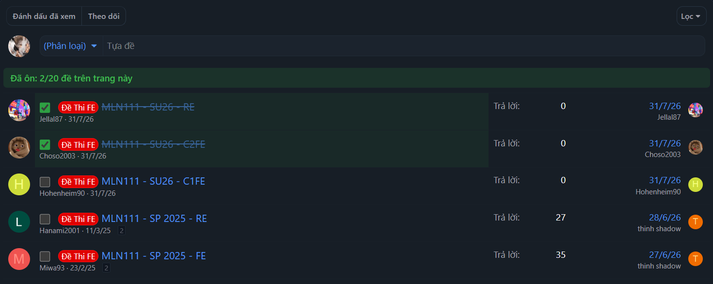
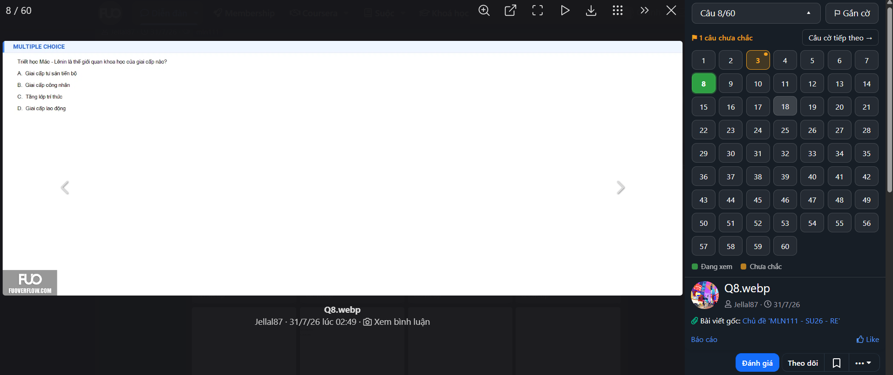

# Extension-Fuoverflow-test-checklist

Extension trình duyệt (Manifest V3) cho diễn đàn [FuOverflow](https://fuoverflow.com), giúp
bạn theo dõi việc ôn đề thi:

- theo dõi trạng thái đề đang học và vị trí câu đang làm dở ngay trên danh sách đề;
- đánh dấu những đề đã ôn xong ngay trên danh sách thread hoặc ngay trong đề;
- nhảy nhanh tới câu bất kỳ khi xem ảnh đề, gắn cờ những câu chưa chắc;
- **chụp màn hình tự động toàn bộ câu hỏi kèm khung chat thảo luận đáp án** (an toàn không bị ban tài khoản, nén sẵn file ZIP).

## Tính năng

### Chụp màn hình kèm khung chat (Khuyên dùng - Có đáp án & Không lo bị ban nick)

Khi ôn đề, đáp án đúng thường nằm ở phần bình luận / thảo luận bên khung chat bên phải. Nếu cào dữ liệu hoặc tải trực tiếp quá nhiều ảnh từ web server, hệ thống sẽ giới hạn hoặc khoá tài khoản (anti-scrape).

Extension bổ sung tính năng **Chụp màn hình tự động**:
- **Chụp tất cả (N câu)**: Tự động lướt qua từng câu, chụp toàn bộ màn hình (gồm cả ảnh câu hỏi và khung chat thảo luận đáp án bên phải) giống như khi bạn tự chụp màn hình, sau đó nén toàn bộ thành file ZIP (`fuoverflow-[id]-kem-chat-tat-ca.zip`).
- **Chụp câu cờ**: Chỉ chụp các câu bạn đã đánh dấu cờ kèm khung chat.
- **Chụp câu này**: Chụp ngay lập tức câu đang xem và lưu thành 1 file PNG riêng lẻ.
- **Tùy chỉnh tốc độ mỗi câu**: Chọn độ trễ chuyển câu (0.7s, 1.0s, 1.5s) để hình ảnh và bình luận kịp tải đầy đủ trước khi chụp.
- **Tự động đóng menu & ẩn nút khi chụp**: Ảnh chụp ra hoàn toàn sạch đẹp, không bị vướng bảng điều khiển.
- **Tạm dừng thông minh**: Nếu bạn chuyển sang tab khác trong khi chụp, quá trình chụp sẽ tạm dừng và tự tiếp tục khi bạn quay lại tab. Có nút **Dừng** bất kỳ lúc nào (các ảnh đã chụp vẫn được nén tải về đầy đủ).

### Theo dõi đề đang học & tiến độ câu
- **Tự động nhận diện khi click vào đề**: Bấm vào bất kỳ link nào của đề (hoặc truy cập trực tiếp trang đề) sẽ tự động hiện nhãn **"Đang học"**.
- **Hiển thị câu đang học**: Khi mở ảnh xem đề trong Lightbox, xem tới ảnh/câu nào (ví dụ câu 8/60) thì trên danh sách đề sẽ hiển thị chính xác **"Đang học tới câu 8/60"**.
- **Tiếp tục học dở**: Khi mở lại Lightbox của đề đang học dở, panel bên phải có nút **"Tiếp tục câu X →"** để nhảy ngay về câu bạn đang xem dở.
- **Nút xoá nhanh trạng thái**: Di chuột vào nhãn "Đang học" có nút `×` nhỏ để xoá trạng thái nếu click nhầm.
- **Đồng bộ thời gian thực**: Tự động đồng bộ ngay lập tức giữa các tab và khi đổi trang mà không cần tải lại trang.
- Trạng thái lưu trong `localStorage` (key `fuo-study-progress`), theo ID thread.

### Checklist đề đã ôn

- Có checkbox đứng trước tiêu đề mỗi thread trong danh sách (và ở tiêu đề trang chi tiết đề).
- Thread đã tick sẽ bị gạch ngang, hiện nhãn **"✓ Đã ôn xong"** và tô nền xanh lá nhạt.
- Thanh tiến độ hiển thị cả tổng số đề đã ôn và số đề đang học trên toàn diễn đàn cũng như trên trang hiện tại.
- Trạng thái lưu trong `localStorage` (key `fuo-test-checklist`), theo ID thread, nên vẫn giữ nguyên khi phân trang, đổi thứ tự hoặc tải lại trang.

### Nhảy câu, gắn cờ & tải ảnh trong lightbox

Khi mở ảnh đề, cột bên phải (phía trên thông tin người đăng) có panel điều khiển:

- Nút **"Câu x/N"**: bấm để mở bảng số và nhảy thẳng tới câu bất kỳ. N lấy theo số ảnh của đề.
- Nút **"Gắn cờ"**: đánh dấu câu đang xem là chưa chắc, bấm lại để bỏ cờ.
- Nút **"Tiếp tục câu X →"**: hiện khi mở lại đề từ câu 1 để nhảy ngay về câu đang học dở.
- Trong bảng số, câu đang xem màu xanh lá, câu có cờ màu cam kèm một chấm nhỏ.
- Nút **"Câu cờ tiếp theo →"**: nhảy qua các câu đã gắn cờ, hết thì quay lại câu đầu.
- Cờ lưu trong `localStorage` (key `fuo-question-flags`), theo ID thread.

## Cài đặt (Brave / Chrome)

1. Mở `brave://extensions` (hoặc `chrome://extensions`).
2. Bật **Developer mode** ở góc trên cùng bên phải.
3. Bấm **Load unpacked** và chọn thư mục này (hoặc nếu đã cài, bấm nút **Reload** hình mũi tên xoay tròn của extension).
4. Mở một trang diễn đàn, ví dụ https://fuoverflow.com/forums/MLN111/.

> Sau khi sửa code hoặc cập nhật extension, hãy nhớ bấm nút **Reload** của extension ở trang extensions rồi **F5** lại trang web FuOverflow.

## Lưu ý

- Cần Brave/Chrome từ bản 111 trở lên (hỗ trợ Manifest V3 và script lightbox chạy trong `"world": "MAIN"`).
- Dữ liệu checklist và cờ lưu riêng theo từng trình duyệt; tick ở Brave sẽ không tự đồng bộ sang Chrome.
